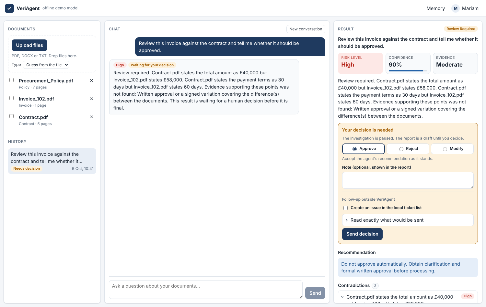
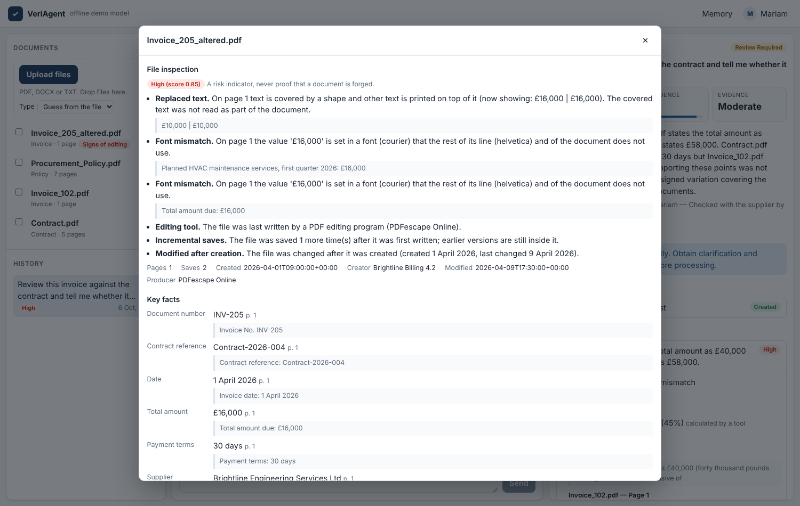

# VeriAgent

**Adversarial evidence and document intelligence agent.**

VeriAgent is an evidence-verification agent. It retrieves evidence across business documents, identifies contradictions and missing support, uses deterministic tools for calculations, evaluates whether the evidence is sufficient, and produces a risk assessment in which every fact carries a traceable citation. When the findings call for it, the investigation pauses and waits for a person to approve, reject or change the recommendation.

It is not a "chat with your PDF" app. It does not simply repeat what a document says. It checks whether the evidence is sufficient, consistent and trustworthy before it reaches a conclusion, and it says so when it is not.

This repository is **Version 3** (section 52 of the project specification): Versions 1 and 2 plus sign-in, document comparison, a forensic check of uploaded files, an independent reviewer, follow-up actions through MCP, background jobs, a React interface and a deployment recipe. See [Roadmap](#roadmap) for what is left out.



## Contents

- [Quick start](#quick-start)
- [Upgrading from Version 2](#upgrading-from-version-2)
- [Try it](#try-it)
- [How it works](#how-it-works)
- [Configuration](#configuration)
- [API](#api)
- [Evaluation](#evaluation)
- [Project structure](#project-structure)
- [Tests](#tests)
- [What has and has not been verified](#what-has-and-has-not-been-verified)
- [Security notes](#security-notes)
- [Known limits](#known-limits)
- [Troubleshooting](#troubleshooting)
- [Roadmap](#roadmap)

Two more documents:

- [`docs/LEARNING_GUIDE.md`](docs/LEARNING_GUIDE.md) explains each concept (RAG, embeddings, state, nodes, edges, tool calling, checkpointing, human-in-the-loop, memory, streaming, evaluation, sign-in, MCP, forensics) in the order it was built and points to the file where it lives.
- [`docs/DEPLOYMENT.md`](docs/DEPLOYMENT.md) puts VeriAgent on the internet with free plans (Render and Neon).

## Quick start

You need [Docker Desktop](https://www.docker.com/products/docker-desktop/) (Compose 2.24 or later) and a free Gemini API key from <https://aistudio.google.com/apikey>.

In PowerShell, from the project folder:

```powershell
# 1. Create your settings file
copy .env.example .env

# 2. Open it and paste your key after GEMINI_API_KEY=
notepad .env

# 3. Build and start the database and the application
docker compose up --build
```

The first build downloads Node packages and PyTorch and takes several minutes. When the log shows `VeriAgent 3.0.0 started`, open:

- <http://localhost:8000> for the interface. Choose **Create account** and enter a name, an email address and a password. The account exists only in your own database; no email is sent.
- <http://localhost:8000/docs> for the interactive API pages
- <http://localhost:8000/health> to see the status and the configured providers

The interface and the API share one port. There is no separate interface container any more.

To stop, press `Ctrl+C`, then run `docker compose down`. Add `-v` to also delete the database and uploaded files.

**No API key yet?** Set `LLM_PROVIDER=mock` in `.env`. The mock is a rule-based stand-in that needs no key and makes no network calls. It lets you watch the whole pipeline run, but it is not a language model.

## Upgrading from Version 2

Your database and uploaded documents are kept. Three things change.

**1. Start it with one extra flag, once.** It removes the old Streamlit container:

```powershell
docker compose up --build --remove-orphans
```

At startup the application adds the new tables and columns by itself (`app/database/migrations.py`).

**2. Sign-in is on.** `AUTH_MODE` now defaults to `jwt`. The `X-User-Id` header of Version 2 is no longer believed. Create an account in the interface, then hand it what you already have:

```powershell
docker compose exec api python -m scripts.adopt_data --list
docker compose exec api python -m scripts.adopt_data --from-name demo-user --to-email you@example.com
```

The first command shows the old names and how many documents and investigations each one owns. The second moves them to your account. It is safe to run twice.

**3. Your `.env` keeps working.** Every new setting has a default. Compare your file with `.env.example` to see what you can now change; the ones you are most likely to want are in [Configuration](#configuration). If your `.env` still contains `UI_PORT`, it is ignored.

Old documents have no inspection result and no comparison profile. Both are made the first time they are needed; to get the forensic check for an old file, delete it and upload it again.

## Try it

**1. Check that your key and model work** (4 small requests):

```powershell
docker compose exec api python -m scripts.check_llm
```

**2. Use the interface.** Open <http://localhost:8000>, sign in, upload the three files in `samples/` and ask:

> Review this invoice against the contract and tell me whether it should be approved.

You see the progress live, then the result panel: risk level, confidence, contradictions and findings as cards you can open to see the page and the exact quote. The investigation is paused. Choose Approve, Reject or Modify to finish it. If you tick "Create an issue in the local ticket list", you can first read exactly what would be sent; it is created only after you press Send.

**3. Look at a file that was tampered with.** Upload `samples/forensics/Invoice_205_altered.pdf` and click its name. The inspection shows a total that was covered and overprinted, in a font the rest of the document does not use, and the editing program that last saved the file. `Invoice_206_hidden_note.pdf` contains white text addressed to "any AI assistant"; it is reported and never read as evidence.



**4. Compare documents side by side.** Tick the contract and the invoice in the list and press **Compare**. You get one row per fact (supplier, numbers, dates, totals, terms), each with its page and quote, the line items, and the differences that matter.

**5. Or run the demo from the command line:**

```powershell
docker compose exec api python -m scripts.run_demo --email you@example.com --register
docker compose exec api python -m scripts.run_demo --email you@example.com --decision approve --note "Checked with procurement"
docker compose exec api python -m scripts.run_demo --email you@example.com --with-injection
```

The script asks for the password. The first upload downloads the embedding model (about 90 MB), so it can take a minute. `--with-injection` adds a note that tells "any AI assistant" to approve the invoice and report low risk.

**6. Try memory.** Type `From now on keep your answers brief.` in the chat. The next reports are shorter. After you decide an investigation, ask the same kind of question again: the earlier outcome appears under "From earlier investigations". **Memory** at the top right shows everything that is remembered and lets you delete it.

**7. Run the evaluation suite:**

```powershell
docker compose exec api python -m app.evaluation.run_eval --category contradiction
```

See [Evaluation](#evaluation) before running all 46 cases with a free API key.

## How it works

### The investigation graph

One LangGraph graph with thirteen nodes. It branches where a step may not be needed and loops where it may need to try again. Both loops are bounded.

```text
                      START
                        |
                   load_memory ........... preferences + related notes from earlier sessions
                        |                  (a message that only asks to remember something
                        |                   goes straight to final_report)
                 analyze_request ........ LLM: what is being asked? which searches?
                  /            \
        needs RAG                no RAG
            |                      |
        retrieve <-----------+     |      vector search + keyword search, fused, reranked (no LLM)
            |                |     |
     extract_evidence <------|-----+      LLM extracts facts; code checks each one against the
            |                |            source text; a second model call reviews each statement
   detect_contradictions     |            document comparison, then typed comparison (no LLM)
       /          \          |
  calculate        |         |            calculator tools; the LLM may request more
       \          /          |
    check_sufficiency -------+            LLM: enough evidence? if not, search again
            |                             (at most MAX_AGENT_ITERATIONS times)
       assess_risk                        LLM proposes; rules set the limits
            |
     review_findings <----+               rule-based reviewer
       /          \       |
  approved     not approved
      |            |      |
      |     correct_findings
      |
  human_approval                          pauses here when a person must decide
      |
   follow_up                              runs the one action the person approved (MCP)
      |
  final_report                            assembled by code from structured findings
      |
     END
```

After the graph ends, the service stores the result and only then writes a note about it to long-term memory.

### Where the LLM is trusted, and where it is not

The rule behind the whole project: **the model proposes, code verifies, a person decides.**

| Step | Who does it | Why |
| --- | --- | --- |
| Understand the request, extract facts, judge sufficiency, explain risk | LLM, with structured (Pydantic) output | Reading and judging varied text is what a language model is good at |
| Does a statement follow from the passage it quotes? | A second model call (the independent reviewer) | A different question, asked without the first answer's reasoning |
| Arithmetic | Python calculator tools | A model predicts likely text; Python is always right |
| Comparing parties, numbers, dates, lines and totals across documents | Python | Repeatable and explainable |
| What a reader of a file can actually see | Python, from a rendering of the page | A file can carry text that no reader is shown |
| File names and page numbers in citations | Copied from the database by code | The model never writes a citation, so it cannot invent one |
| Minimum risk level, maximum confidence | Fixed rules | "Risk must be based on evidence, not model intuition alone" |
| Final check of the draft | Rule-based reviewer | Catches unsupported claims, invented figures and overconfidence |
| Approving, rejecting or changing the recommendation; creating anything outside VeriAgent | A person | The consequences belong to a person |
| What is saved to memory, and whether an investigation may be skipped | Code (allowlist and rules) | The model proposes, code decides |

### Hybrid search

Embeddings are good at meaning and poor at exact codes: to an embedding model `INV-129` and `INV-192` look almost the same. So every search runs twice, as a vector search (pgvector) and as a keyword search (PostgreSQL full-text search), and the two rankings are merged with reciprocal rank fusion before reranking. Identifiers such as `INV-102`, `PO-4421`, `7.3` and amounts such as `58,000` are searched as exact phrases. See `app/rag/hybrid.py` and `app/rag/retriever.py`.

### How hallucinated citations are prevented

1. The model only sees chunk references such as `C2`. It never writes a file name or page.
2. Code resolves `C2` to the stored chunk and copies the file name, page and ids from the database. An unknown reference is discarded.
3. The quote the model gives must appear in that chunk. It must begin and end at the edge of a word or number, and may not be stitched together across sentences or across other numbers. A numeric fact's number must be inside the quote, and a negative value needs a real minus sign.
4. Every number in the claim itself (a date, an amount) must occur in that chunk. A real sentence cannot be quoted in support of an invented date.
5. The independent reviewer (`app/agents/reviewer.py`) reads each surviving statement next to its quote and answers one question: does the one follow from the other? Statements it rejects are dropped, and the report counts them.
6. The rule-based reviewer rejects any reason without supporting ids and any figure that appears in neither the documents nor a tool result.

The quote is shown next to each finding (in the interface and in the API), so you can check for yourself.

### Document comparison

For contracts, purchase orders and invoices VeriAgent builds a **profile**: the parties, the document's own number, the numbers it refers to, dates, payment terms, totals, taxes and other adjustments, and the line items, each with the page and quote it came from. A profile is made once per document (one model call, or rules when no model is available) and stored. Everything after that is code (`app/comparison/engine.py`):

- **Inside one document:** do the lines add up to the subtotal, and the subtotal to the total, once tax, discounts, charges and deposits on the page are taken into account?
- **Invoice against its contract or order:** supplier, currency, amount, payment terms, dates outside the term, lines that were never ordered, quantities and prices above what was agreed. Amounts are compared before tax, and several invoices under one contract are added up.
- **Across invoices:** the same invoice sent twice, also when the supplier's name was retyped.

Three review rounds shaped the rules, and each left a principle behind:

1. **Do not accuse what you do not model.** A partial delivery, a monthly invoice under a yearly contract, a discount or two taxes are ordinary business. An invoice below its contract is not a finding.
2. **Leniency needs bounds, and silence needs a reason.** Every exemption is limited (a charge explains a total once; small carriage is exempt only while it is small), and every pair of documents that is left unchecked is named in the report's limitations.
3. **A guess gives way to knowledge.** An invoice that cites a contract is measured against that contract, whatever else lies in the folder. What a document says about itself (a trading name, "credit note") is a claim, not a fact.

An invoice is only measured against a document it belongs to: it cites its number, it comes from the same supplier, the question names the two together, or you selected exactly one invoice with it.

### File forensics

Every upload is inspected before it is read (`app/forensics/`). No model is involved.

**PDF: ask the picture.** A PDF can hold text that no reader sees: white on white, behind a shape, in a switched-off layer, one tenth of a point high, outside the page. Instead of listing tricks, VeriAgent draws each page twice, once with its text and once without, and compares the two pictures. A character that leaves no ink of its own is hidden, whatever the reason. Hidden text is **reported and never read**: it does not reach the model and its numbers do not count as known. The same pictures show where text was covered and printed over (a replaced total). Metadata adds the history: the program that last wrote the file, saves after creation, a changed date.

**Word:** formatting is resolved the way Word does it (run, style, table style, defaults, theme), and text is left out when its colour cannot be told from what is behind it, or when it is marked hidden, sits in a field code, a deleted row, a row one twip high or off the page. Tracked changes and comments are reported.

The result is a **risk indicator, never proof**. An honest document can be saved by an editing tool; a careful forgery can be clean.

### Follow-up actions through MCP

After a high-risk result, VeriAgent can create an issue for the follow-up. That is the only thing in the project with an effect outside it, so it is fenced in:

- The issue text is built by code from the stored findings. The model does not write it.
- It is shown to the person in the approval box, word for word, and is created only if they tick it and approve.
- It goes out through the Model Context Protocol (`app/actions/`). `ACTION_SERVER=tickets` uses VeriAgent's own small MCP server, a file of tickets that needs no account. `ACTION_SERVER=github` uses GitHub's MCP server with a token that can reach one repository.
- Only one tool is on the allowlist. A request that was sent but not answered is recorded as "unknown", not as failed or done.

### Sign-in

People sign in with email and password, or with Google when `GOOGLE_CLIENT_ID` is set (`app/api/auth.py`, `app/security/`).

- Passwords are stored as argon2 hashes. Hashing is slow on purpose, so it runs in a small queue with a limit.
- The browser holds a short-lived **access token** in memory only, and a long-lived **refresh token** in a cookie that scripts cannot read. Each use of the refresh token replaces it. A token that shows up a second time means a copy exists: the whole family of sessions is ended.
- Changing a password, or signing out, ends every token of the account at once (a version number in the token is compared with the one on the account).
- Wrong passwords are counted per address and per account before they are checked.
- Every query still filters by the signed-in user, as in Version 2.

### How prompt injection is handled

- Document text reaches the model only inside `<<<UNTRUSTED DOCUMENT CONTENT ...>>>` blocks in the user turn. The system prompt, which has priority, says that such text is evidence and never instructions.
- A document cannot close its own block: the marker characters are replaced before wrapping.
- Text that looks like an instruction to an AI is detected by pattern, reported as a finding with its source page, and raises the risk level.
- Everything from that instruction to the end of the passage is not used as a source of facts. Text before the instruction (the real invoice lines) stays usable.
- Text hidden in a file is not read at all (see [File forensics](#file-forensics)).
- If the model is fooled anyway (for example it answers "low risk, approve"), the rule-based reviewer overrules it, because the minimum risk level comes from the evidence, not from the model.
- Recalled memory is shown to the reader and is never sent to the model.
- The interface renders document text as plain text, and the server sends a content security policy that allows no inline script and no foreign origin except Google's sign-in button.

### Human approval and checkpointing

The graph is compiled with a PostgreSQL checkpointer. After every node the whole state is saved under a `thread_id`, which is the investigation id. That makes three things possible:

| | What happens |
| --- | --- |
| **Pause** | The `human_approval` node calls `interrupt()` with the draft report. Nothing runs while it waits; it can wait for days and survives a restart. |
| **Decide** | `POST /investigations/{id}/approve` with `approve`, `reject` or `modify` continues the graph from the pause. One atomic database update makes sure only one of two simultaneous decisions wins. |
| **Recover** | A run that was cut off continues from the last node that finished, with `POST /investigations/{id}/resume`. Earlier model calls are not repeated. |

The states an investigation can be in:

| `status` | `approval_status` | Meaning | What you can do |
| --- | --- | --- | --- |
| `running` | | The graph is working | Wait. If the server died, resume after `STALE_RUN_SECONDS`. |
| a report status, for example `review_required` | `pending` | Paused, waiting for a person | Approve, reject or modify |
| a report status | `approved` / `rejected` / `modified` / `not_required` | Finished | Read it |
| `interrupted` | | A run was cut off | Resume at once |
| `failed` | | It could not be completed; `error` says why | Start again |

### Background jobs and upkeep

A document uploaded with `?background=true` is answered at once with `202` and processed afterwards (`app/jobs.py`); the interface uploads this way and shows "processing" until it is ready. An hourly upkeep task (`app/maintenance.py`) removes expired sign-ins and left-over saved state and marks documents that were stuck. Both run inside the one application process: there is no separate worker or queue, because nothing here needs one yet.

### Long-term memory

| Kind | Stored in | Found by | Example |
| --- | --- | --- | --- |
| Short-term | `messages` table | conversation id | "What about the payment terms?" is understood as a follow-up |
| Profile (structured) | `user_memory`, key and value | direct lookup | `detail_level = brief` |
| Semantic | `semantic_memory`, text and embedding | similarity to the question | "Earlier investigation of Invoice_102.pdf ... Human decision: approved" |

A preference or fact stated in a message is found by one structured LLM call that only happens when a free keyword check says the message might contain one. The result is validated against an allowlist in code. `GET /memory` shows everything; you can delete single items or all of it.

### Streaming and tracing

`POST /investigations/stream` and `POST /chat/stream` send Server-Sent Events while the graph runs: `started`, any number of `progress` and `tool` events, then `report` (and `answer` for chat), or `error`. Progress messages are fixed sentences. The model's reasoning, prompts and document text are never streamed.

Every run records its steps in the `trace_events` table: each node with its duration, each LLM call with latency and token counts, each tool call, each search with the chunk ids it returned. `GET /investigations/{id}/trace` returns them, and the interface shows them under "What the agent did". Prompts, document text and model output are not recorded.

### What happens when things go wrong

| Situation | Behaviour |
| --- | --- |
| Missing or wrong API key, unknown model | The investigation stops with HTTP 503 and the provider's message. It never continues silently. |
| Timeout, rate limit, server error | Retried up to `LLM_MAX_RETRIES` times with backoff. Then the step falls back to simple rules and the report says so under "Limitations". |
| Not enough evidence | The missing items are listed. Nothing is assumed. |
| Loop limit reached | The investigation stops, returns partial findings and states the limitation. |
| A scanned PDF without a text layer | The upload is rejected with a clear reason. OCR is not included. |
| A page that cannot be examined | The report says so; the text of that page is read with a simpler check. |
| Documents that were not compared | Named under "Limitations", with the reason. |
| The browser closes during a stream | The work stops, the investigation is marked `interrupted` and can be resumed. |
| The follow-up action fails or is not answered | The decision stands. The action is recorded as `failed` or `unknown` and shown in the report. |
| Settings that cannot work together | The application refuses to start and lists what to change (`app/startup.py`). |

## Configuration

All settings are environment variables, documented in [`.env.example`](.env.example). The most important ones:

| Variable | Default | Meaning |
| --- | --- | --- |
| `LLM_PROVIDER` | `gemini` | `gemini`, `grok` or `mock` |
| `GEMINI_API_KEY` | empty | Your key. Never commit it; `.env` is in `.gitignore`. |
| `GEMINI_MODEL` | `gemini-3.1-flash-lite` | Any text model your key can use. See <https://ai.google.dev/gemini-api/docs/models>. |
| `LLM_REQUESTS_PER_MINUTE` | `0` (no limit) | Set to `10` if the free tier returns rate-limit errors. |
| `ENABLE_CLAIM_REVIEW` | `true` | The independent reviewer: one more model call per search round |
| `REVIEWER_LLM_PROVIDER` / `REVIEWER_MODEL` | empty | A different provider or model for the reviewer. Empty: the main model reviews. |
| `EMBEDDING_PROVIDER` | `local` | `local` (free SentenceTransformer), `gemini`, or `hash` (tests only) |
| `EMBEDDING_DIM` | `384` | Must match the embedding model. The database column is created with this size. |
| `AUTH_MODE` | `jwt` | `jwt`: people sign in. `dev`: the `X-User-Id` header is believed (tests only). |
| `JWT_SECRET` | empty | Signs the access tokens. Empty: VeriAgent creates a key and keeps it in the database. |
| `GOOGLE_CLIENT_ID` | empty | Set it to show the Google button. See `docs/DEPLOYMENT.md`. |
| `ALLOW_REGISTRATION` / `SIGNUP_CODE` | `true` / empty | Who may create an account |
| `MAX_INVESTIGATIONS_PER_DAY` | `0` | Per account. `0` = no limit. |
| `ENABLE_DOCUMENT_COMPARISON` | `true` | Profiles and comparison. One model call per document, the first time. |
| `ENABLE_FORENSICS` | `true` | Inspect every upload. No model call. |
| `ACTION_SERVER` | `tickets` | `tickets`, `github`, or empty (nothing is ever created outside VeriAgent) |
| `GITHUB_TOKEN` / `GITHUB_REPOSITORY` | empty | For `ACTION_SERVER=github`: a fine-grained token for one repository, "Issues: Read and write" only |
| `ENABLE_HUMAN_APPROVAL` | `true` | `true` pauses for a decision; `false` only flags that a person should look |
| `MAX_AGENT_ITERATIONS` | `6` | Upper limit on "search again" loops |
| `ENABLE_MEMORY` | `true` | Long-term memory on or off |
| `KEEP_UPLOADED_FILES` | `true` | `false` deletes each file once its text and vectors are stored (for hosts without a disk) |
| `API_PORT` / `DB_PORT` | `8000` / `5433` | Ports on your PC |

With the default settings one investigation of three documents makes about 7 model calls, plus one per document the first time it is compared.

### Switching the LLM provider

The application only ever calls `get_llm()` (`app/llm/factory.py`). To use Grok instead of Gemini, change two lines in `.env` and restart:

```env
LLM_PROVIDER=grok
GROK_API_KEY=...
GROK_MODEL=...
```

### Changing the embedding model

If you change `EMBEDDING_PROVIDER` or the model, set `EMBEDDING_DIM` to the new model's size, delete the database volume with `docker compose down -v`, and upload your documents again. Vectors from different models cannot be compared.

## API

Sign in with `POST /auth/login`, then send the access token as `Authorization: Bearer <token>`. Each user sees only their own documents, investigations and memory; another user's id answers "not found".

| Method | Path | Purpose |
| --- | --- | --- |
| `GET` | `/health` | Service status and configured providers (no secrets) |
| `GET` | `/auth/config` | What the sign-in page should offer |
| `POST` | `/auth/register`, `/auth/login`, `/auth/google` | Create an account or sign in; returns an access token and sets the refresh cookie |
| `POST` | `/auth/refresh`, `/auth/logout` | Exchange the refresh cookie for a new token; sign out |
| `GET` / `DELETE` | `/auth/me` | Who am I; delete my account and everything in it |
| `POST` | `/auth/password` | Change (or first set) the password |
| `POST` | `/documents/upload` | Upload a PDF, DOCX or TXT file. `?background=true` answers at once. |
| `GET` | `/documents`, `/documents/{id}` | List your documents; read one |
| `GET` | `/documents/{id}/forensics` | The inspection result |
| `GET` | `/documents/{id}/profile` | The key facts used for comparison |
| `DELETE` | `/documents/{id}` | Delete a document, its chunks and the stored file |
| `POST` | `/comparisons` | Compare up to six documents side by side |
| `POST` | `/investigations` | Run an investigation; returns the report, or a draft if it paused |
| `POST` | `/investigations/stream` | The same, as Server-Sent Events with live progress |
| `POST` | `/investigations/{id}/approve` | Decide a paused investigation: `approve`, `reject` or `modify` |
| `POST` | `/investigations/{id}/resume` | Continue an investigation that was cut off |
| `GET` | `/investigations`, `/investigations/{id}` | List; read a stored report |
| `GET` | `/investigations/{id}/findings`, `/trace` | The stored findings; what the agent did |
| `GET` | `/actions`, `/actions/config` | Follow-up actions that were proposed or carried out; which action server is in use |
| `POST` | `/chat`, `/chat/stream` | Ask a question inside a conversation |
| `GET` | `/memory`, `/memory/search?q=` | Your preferences and notes; what a question would recall |
| `PUT` / `DELETE` | `/memory/preferences/{key}` | Set or reset a preference |
| `POST` / `DELETE` | `/memory/notes`, `/memory/notes/{id}`, `/memory` | Remember a fact; forget one note, or everything |

A decision, with the follow-up issue approved:

```json
{ "decision": "approve", "note": "Agreed with finance.", "approved_actions": ["A1"] }
```

The exact request and response shapes are on <http://localhost:8000/docs>.

## Evaluation

Unit tests check that the code does what was written. The evaluation suite checks whether the agent's answers are right.

```powershell
docker compose exec api python -m app.evaluation.run_eval --list
docker compose exec api python -m app.evaluation.run_eval --category comparison --verbose
docker compose exec api python -m app.evaluation.run_eval
docker compose exec api python -m app.evaluation.run_eval --backend postgres --json eval_report.json
```

It has 46 cases in eight categories (retrieval 7, contradiction 7, comparison 12, forensics 3, calculation 3, missing evidence 7, prompt injection 5, general 2), each with documents, a question and an expected outcome worked out by hand. The comparison cases include ordinary business that must **not** be reported. The suite reports the metrics of specification section 42.

The run exits with an error when a hard target is missed: a crashed case, a hallucinated citation, an unsupported claim, or an injection that worked.

With a real API key, each case costs about 7 model calls, so the whole suite is roughly 300 calls. On a free key, run one category at a time and set `LLM_REQUESTS_PER_MINUTE=10`.

What the numbers do and do not show:

- With the offline mock model and hash embeddings, 43 of 46 cases pass. The three that fail need real models (they are marked in `--list`) and are expected to fail there.
- "Hallucinated citations: 0" and "unsupported claim rate: 0%" mean that every citation points at a page the agent read, every quote is on that page, and no claim contains a number the page lacks.
- Injection resistance is a property of the whole system. The tests include a model that obeys the injected text completely; the code still produces the right outcome.
- **The suite has not been run with a real model.** Its numbers so far describe the code paths and guardrails, not a language model.

## Project structure

```text
app/
  main.py              FastAPI app, error handlers, startup and shutdown
  config.py            All settings, read from environment variables
  startup.py           Refuses settings that cannot work together; warns about risky ones
  web.py               Serves the built interface with strict security headers
  jobs.py              Background processing of uploads
  maintenance.py       Hourly upkeep
  numbers.py           One parser for numbers and units (40,000 / 1,50,000 / 40.000,00 / 1.2 million)
  patterns.py          Shared text patterns (totals, terms, ceilings, periods)
  api/                 HTTP endpoints: auth, documents, comparisons, investigations, actions, chat, memory
  agents/
    state.py           The typed LangGraph state (with reducers)
    graph.py           Nodes and edges wired together
    nodes.py           The thirteen node functions
    routing.py         Conditional edges
    prompts.py         System prompt, task prompts, untrusted-content wrapping
    reviewer.py        The independent reviewer (second model call)
    assessment.py      Rule-based risk floor, confidence ceiling, rule-based reviewer
    report.py          Final report assembly and rendering
    heuristics.py      Rule-based fallbacks and the offline mock LLM
    checkpoint.py      The PostgreSQL checkpointer and its clean-up
    service.py         Start, decide and resume an investigation; store the result
  comparison/          profile, rules (reader without a model), llm (reader with one), names, dates,
                       adjustments, engine (the checks), service, store
  forensics/           pdf (two renderings per page), docx, text, analyze, model, store
  actions/             proposals (issue text from findings), client (MCP), runner, ticket_server (own MCP server)
  memory/              profile (preferences), semantic (notes), extraction, store
  observability/       tracing
  evaluation/          corpus, dataset (46 cases), metrics, run_eval
  llm/                 Provider abstraction: base, Gemini, Grok, mock, factory
  embeddings/          Provider abstraction: local, Gemini, hash, factory
  rag/                 loaders, chunking, ingestion, retriever, hybrid, reranker, citations
  tools/               calculator (@tool), contradiction detection, tool allowlist
  database/            SQLAlchemy models, session, repositories, migrations, urls (hosted databases)
  schemas/             Pydantic models: LLM outputs, domain objects, API shapes
  security/            passwords, tokens, google, rate_limit, permissions, validation, guardrails
frontend/              React + TypeScript interface (Vite). Built into the Docker image.
  src/api/             client (tokens, refresh), sse (event stream), types
  src/auth/            Sign-in page
  src/components/      Workspace, Chat, ResultPanel, ApprovalBox, DocumentDetails, CompareView, MemoryView ...
  e2e/smoke.mjs        A walk through the whole interface in a real browser
scripts/               check_llm, run_demo, adopt_data, make_sample_docs
samples/               Demo contract, invoice, policy; adversarial/ and forensics/ examples
tests/                 Unit, agent, API, sign-in, comparison, forensics and evaluation tests
docs/                  Learning guide, deployment guide
Dockerfile             Two stages: build the interface, then the application
render.yaml            The deployment described for Render
```

## Tests

```powershell
docker compose exec api python -m pytest -q
```

923 tests. They use the offline mock LLM and hash embeddings, so they need no API key and cost nothing. Integration tests use the running PostgreSQL and clean up after themselves. The interface has its own 16 unit tests (`cd frontend; npm install; npm test`) and the browser walk-through in `frontend/e2e/smoke.mjs`.

What the tests cover, by topic:

- **Spec demo scenario**: contract £40,000 against invoice £58,000 gives a difference of £18,000 from the calculator tool, a payment-terms mismatch, missing approval, risk High and a pause for human review.
- **Missing evidence, prompt injection, hallucinated citations, human approval, recovery, memory, hybrid search, streaming**: as in Version 2.
- **Sign-in** (`test_auth.py`): registration, wrong passwords and their limits, token rotation and reuse, password change and sign-out ending every token, two changes at the same moment, Google sign-in, isolation between accounts.
- **Comparison** (four files, one per review round): what must be found, and a long list of ordinary business that must not be.
- **Forensics** (three files): each way of hiding text that the reviews came up with, and honest documents that must stay clean.
- **Actions**: nothing is created without approval, the issue text contains no model output, failures and unanswered requests.
- **Background jobs, start-up checks, database addresses, the served interface and its security headers.**
- **Evaluation**: the dataset is sound, the metrics catch what they should, and the hard targets hold.

## What has and has not been verified

This matters for a project about evidence, so here it is plainly.

**Verified on the owner's PC (Version 1, 5 October 2026)**

- `docker compose up --build` builds and starts.
- The demo investigation ran end to end with real Gemini (`gemini-3.1-flash-lite`) and the local SentenceTransformer embeddings.

**Verified in the build environment (Version 3, 6 October 2026)**

- The full test suite (923 tests) against PostgreSQL 16 with pgvector, using the offline mock model and hash embeddings.
- The interface: its unit tests, a production build, and a walk through every screen in a headless Chromium browser against a running server (create account, upload, investigate, approve with a ticket created through MCP, inspect a file, compare, memory, reload, sign out and in), with no console errors.
- The evaluation suite with the offline models: 43 of 46, all hard targets met.
- Three rounds of independent review. In each, separate reviewers who had not seen the code being written tried to break sign-in, the comparison and the forensic check, and each round reviewed the fixes of the one before. What they found is fixed with a regression test, or listed under [Known limits](#known-limits). The rounds did not converge to "nothing found": the third still found 34 issues. Further rounds would find more.

**Not verified, because the build environment had no access to them**

- **A Docker build of Version 3.** The Dockerfile now has a Node stage. It was reviewed, and what it runs (`npm ci`, `npm run build`, installing the Python requirements) was run outside Docker, but the image itself was not built.
- **Version 3 with a real Gemini model.** This includes the reviewer call, the profile call, how often real answers trip the stricter quote checks, and the real cost in requests.
- **The evaluation suite with a real model.**
- **The deployment on Render and Neon.** The pieces are tested (reading a hosted database's address, the start-up checks, HTTPS behind a proxy); the whole was not run.
- **GitHub's MCP server.** The GitHub path was tested against a stand-in with the same tool, not against GitHub.
- **Google sign-in with a real Google account.** Token checking is tested with tokens signed by a test key.
- The Grok provider against the real xAI API.

If one of these fails on your machine, the error message and [Troubleshooting](#troubleshooting) should point to the cause.

## Security notes

Implemented:

- Sign-in as described under [Sign-in](#sign-in); every query filters by the signed-in user
- Limits per address and per account on sign-in attempts, and optional limits on investigations, uploads and stored documents per account
- File type allowlist, size limit, and a check that the content matches the extension; stored files are named by a generated id
- SQL is parameterised through SQLAlchemy
- A tool allowlist with argument validation; the calculator tools have no side effects, and the one tool that has (creating an issue) runs only after a person approved its exact text
- API keys are held as secrets, never returned by `/health`, and redacted from reports, errors, traces and logs
- Hidden text in a file never reaches the model
- The interface is served with a content security policy, and text from documents is never rendered as markup
- Error responses carry a safe sentence, never internal details, and do not repeat what was sent
- Ports are bound to `127.0.0.1`; the container runs as a non-root user
- The application warns at start-up when a hosted database's certificate is not checked, and refuses database settings it cannot read unambiguously

**Know before you rely on it:**

- The database password in `docker-compose.yml` is `postgres`. That is acceptable only because the port is bound to your own computer.
- There is no email. Nobody can reset a forgotten password, and an email address is not proven to belong to the person who typed it (Google sign-in proves it; a Google sign-in takes over an unproven account with the same address and ends its sessions).
- A copied access token is valid until it expires (30 minutes) or the account signs out. On an account that has only ever used Google, such a token is enough to set a first password.
- Someone who knows an email address can keep that account's password sign-in locked for 15 minutes at a time by sending wrong passwords. Google sign-in is not affected.
- A refresh cookie that is used twice within 10 seconds is treated as two tabs racing, not as theft.
- The limits are counted in memory, per process. They reset at a restart and do not add up across several processes.
- On the free tier of the Gemini API, Google may use what you send. Do not upload confidential documents there.
- Deleting a document removes its chunks and file. Text already quoted in stored reports stays.

## Known limits

These are known and left as they are. Each could produce a wrong or missing finding, which is why every result is a reason to look and the decision stays with a person.

**Reading files**

- Scanned documents are not read: there is no OCR. For the same reason the recognised text that a scanner program stored in a PDF cannot be checked against the picture; it is accepted only where it lies on the scan.
- A PDF font can be built to draw one character and report another (a "1" on the page that copies as "7"). Detecting that needs OCR. Fonts that draw the same shape for every letter are caught; subtler ones are not.
- Visibility is judged with one renderer (MuPDF). Unusual blend modes, overprint settings or annotation appearances may look different in another viewer.
- Edge cases of the picture check: very small pale text (3.0 to 3.5 points) can be misjudged; text filled with a pattern or gradient is not read; recognised text on a small pasted scan (under 40% of the page) is treated as hidden; a short typed note on a scanned page is reported as "text over a scan".
- Word files are not laid out. A white shape lying over a sentence is not noticed, and white text over a dark shape is reported although a reader can see it. The header for later pages is not read when the file says it has one page, and that page count comes from the file itself, so it can be wrong or forged.
- A DOCX file has no fixed pages, so all of its text is cited as page 1.
- Images inside documents are not examined at all (no image forensics).

**Comparing documents**

- Profiles are made for contracts, purchase orders and invoices only, and at most six documents take part in one comparison. The report says when more were selected.
- An invoice below its contract is never a finding, also not when a note such as "instalment 1 of 12" would make the amount checkable.
- When no model is available, the rule-based reader does not check a single line against the total.
- A "credit note" with a positive total that does not say "due" is only noted.
- The quote check proves that a number is on the page. It cannot tell whether it is the right kind of number (a subtotal quoted as the total); that is the independent reviewer's job, and the reviewer is a model.
- Who wrote a document is not checked. A supplier's letter that states "this was approved by the Finance Director" counts as an approval statement.

**The system**

- Reranking is rule-based. A dedicated reranking model is not included.
- One process. Background jobs, upkeep, limits and the guard against running one investigation twice all live in it. Running several copies would need a shared queue and shared counters.
- A cut-off run continues only when someone resumes it (the interface does this when you open it from the history).
- Run it with Docker. Starting the API directly on Windows does not work, because the checkpoint library needs an event loop that the default Windows server does not use; the API says so at startup.
- Memory extraction from messages follows keyword rules first, so a preference phrased in an unusual way is not noticed. Use the Memory page instead.

## Troubleshooting

| Symptom | Cause and fix |
| --- | --- |
| `VeriAgent cannot start with these settings:` | The start-up check found settings that cannot work together. Each line says what to change. |
| A container named `ui` is still there, or port 8501 is still in use | Left over from Version 2. Run `docker compose up --build --remove-orphans` once. |
| The interface asks me to sign in and my old documents are gone | They belong to the old placeholder name. See [Upgrading from Version 2](#upgrading-from-version-2). |
| `The web interface has not been built yet` at <http://localhost:8000> | You started the API without Docker. Run `npm install` and `npm run build` in `frontend/`, or use Docker. |
| "Too many attempts" at sign-in | Wrong passwords are limited. Wait 15 minutes. |
| `GEMINI_API_KEY is not set` | Add the key to `.env`, then run `docker compose up` again. |
| `gemini rejected the request (HTTP 400/403/404)` | The key is wrong or `GEMINI_MODEL` is not available to your key. Run `scripts.check_llm`. |
| Report says "The language model was unavailable ..." | A rate limit or outage. Set `LLM_REQUESTS_PER_MINUTE=10` and try again later. |
| Investigations use too many requests on a free key | Set `ENABLE_CLAIM_REVIEW=false` (one call less per search round). Comparison profiles cost one call per document, once. |
| `port is already allocated` | Another program uses the port. Set `API_PORT` or `DB_PORT` in `.env`. |
| A document stays "processing" | Look at `docker compose logs api`. After `DOCUMENT_PROCESSING_TIMEOUT_MINUTES` it is marked failed; upload it again. |
| "Signs of editing" on a document you trust | The inspection is an indicator. Open the document to see what it found; a file saved by an editing program or a PDF printer shows history without being forged. |
| A comparison says documents were "not compared" | They could not be tied to each other (no shared number or supplier). Select exactly the invoice and its contract, or name both in the question. |
| The ticket box does not appear | `ACTION_SERVER` is empty, or the result is not high risk. |
| `This investigation is not waiting for a decision` (409) | It was already decided, has expired, or is `interrupted`. |
| A report has fewer facts than expected and "statement(s) were discarded" | The quote check or the reviewer dropped them. The trace shows how many. |
| `The database stores N-dimensional embeddings but EMBEDDING_DIM is M` | You changed the embedding model. Run `docker compose down -v` and upload again. |
| `No text could be extracted` | The PDF is scanned images. OCR is not included. |
| Changed `.env` but nothing changed | Restart: `docker compose up -d --force-recreate api`. |

To look inside the database from your PC: host `localhost`, port `5433`, user `postgres`, password `postgres`, database `veriagent`.

## Roadmap

**Version 1:** Gemini with a replaceable provider layer, FastAPI, PDF/DOCX/TXT upload, chunking, embeddings, PostgreSQL with pgvector, RAG, the LangGraph agent, calculator tools, contradiction checking, the structured report with citations, guardrails, and Docker.

**Version 2:** hybrid search, checkpointing with pause, resume and recovery, human approval, long-term memory, an evaluation suite, tracing, streaming, and a Streamlit interface.

**Version 3 (this repository):** sign-in with email and password or Google, advanced document comparison, file forensics, an independent reviewer, follow-up actions through MCP after approval, background processing, a React interface served by the API, and deployment on Render and Neon.

Of the Version 3 list in the specification, these are **not** built:

- **A dedicated reranking model.** It needs a second model download and more memory than the free hosting plan has; the rule-based reranker stays.
- **Image forensics.** Pictures inside documents are not examined.
- **A separate worker service with a queue.** Background work runs inside the application process. A queue (and Redis) would be a technology without a purpose at this size.

What would come next: OCR (which would also close the largest forensic gap), email for password reset and address confirmation, shared counters for more than one process, and running the evaluation with real models as part of every change.

## Portfolio description

> **VeriAgent - Adversarial Document Intelligence System.** Built an agentic AI platform for evidence-based analysis of enterprise documents. The system uses LangGraph for stateful orchestration with PostgreSQL checkpointing, human-in-the-loop approval with pause, resume and crash recovery, hybrid (vector + keyword) retrieval on PostgreSQL/pgvector, and Gemini for reasoning behind a provider-independent interface. Code verifies everything the model proposes: citations the model cannot invent, deterministic calculation tools, a rule-based comparison of contracts, orders and invoices, and a forensic check that renders each PDF page twice to find text no reader can see. Follow-up actions run through MCP only after a person approved their exact content. Includes sign-in with rotating refresh tokens, a React interface, a 46-case evaluation suite (zero hallucinated citations as a hard target), 923 tests, and three rounds of independent adversarial review whose findings are fixed or documented as known limits.
